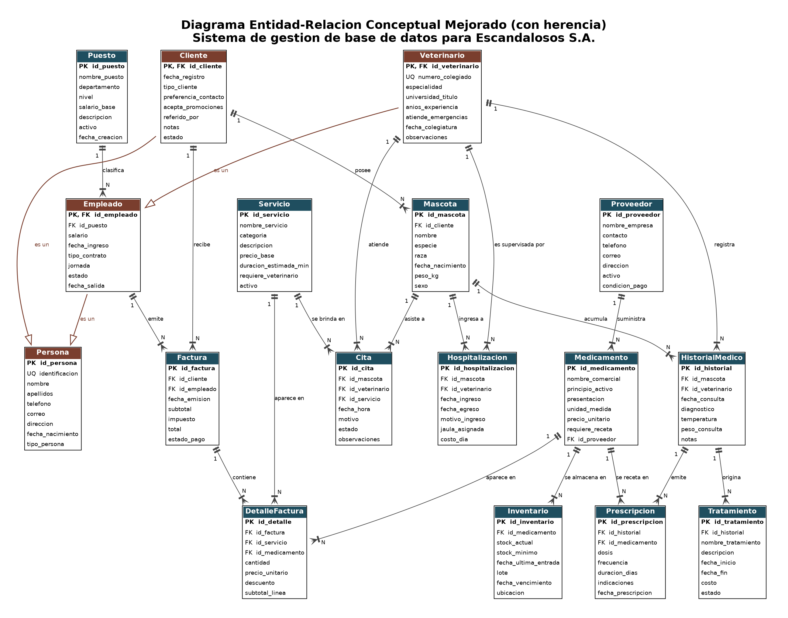
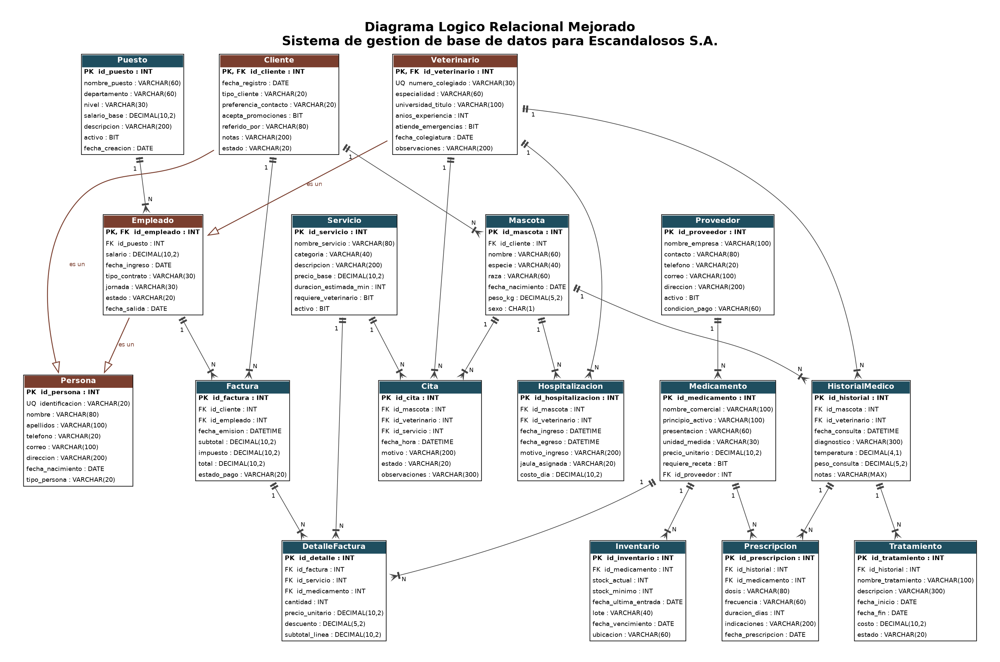
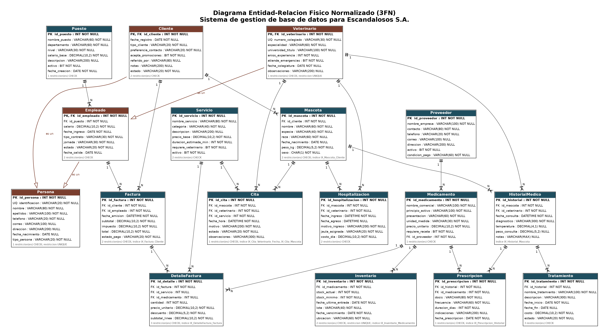

# Base de datos EscandalososSA

Base de datos relacional en Microsoft SQL Server (T-SQL) para Escandalosos S.A., una clínica veterinaria ficticia creada con fines académicos. El proyecto cubre el modelado conceptual y lógico con herencia, la implementación física en SQL Server, y la documentación completa del diseño.

## Autoría y contexto

Este proyecto fue diseñado y desarrollado por Kevin Villalobos Obando con el apoyo de Claude (Anthropic) como asistente de desarrollo. Se presentó como entrega del curso de Bases de Datos de ULACIT, que se evaluó bajo formato de equipo. El modelado, los scripts SQL, los diagramas, los generadores en Python y la documentación de este repositorio son trabajo de Kevin junto con Claude.

## Problema que resuelve

1. **Gestión manual de registros.** Los historiales médicos se llevaban en fichas de papel. Ahora existe un historial médico centralizado y consultable.
2. **Inconsistencia de inventario.** Las hojas de cálculo de existencias no estaban integradas con la facturación. Ahora un trigger descuenta el stock al facturar un medicamento y rechaza la venta si no hay existencias suficientes.
3. **Ausencia de control de citas.** La agenda física permitía dobles reservas. Ahora un procedimiento almacenado y un trigger bloquean el choque de horario de un veterinario.
4. **Dificultad para generar reportes.** Ahora hay vistas y un procedimiento de reporte de ingresos por periodo que resumen la operación sin consultas manuales.

## Características técnicas

* 17 entidades del modelo lógico, más una tabla de auditoría de apoyo (18 tablas en total).
* Jerarquía de herencia: Persona como supertipo de Cliente y Empleado, con Veterinario como subtipo de Empleado.
* Modelo normalizado en tercera forma normal, con una excepción aceptada y documentada en los campos derivados de Factura.
* 8 índices no agrupados sobre columnas de búsqueda y de join frecuentes.
* 5 vistas, 3 procedimientos almacenados y 3 triggers.
* 377 registros de carga, todos ficticios.

## Diagramas

### Diagrama entidad relación conceptual mejorado



Modelo conceptual con la jerarquía de herencia ya incorporada (Persona, Cliente, Empleado, Veterinario), antes de traducirlo a tablas físicas.

### Diagrama lógico relacional mejorado



Traducción del modelo conceptual a esquema relacional, con claves primarias, claves foráneas y tipos de dato lógicos por columna.

### Diagrama entidad relación, versión final


Versión final del modelo entidad relación, correspondiente a la entrega final del proyecto.

### Diagrama entidad relación físico normalizado (3FN)



Modelo físico tal como quedó implementado en SQL Server: tipos de dato exactos, restricciones CHECK y UNIQUE, e índices, ya en tercera forma normal.

## Modelo de datos

| Entidad | Propósito |
| --- | --- |
| Persona | Supertipo con datos personales comunes (cédula única, nombre, contacto) |
| Cliente | Subtipo de Persona, datos comerciales (tipo, preferencia de contacto, estado) |
| Empleado | Subtipo de Persona, datos laborales (puesto, salario, contrato, jornada) |
| Veterinario | Subtipo de Empleado, datos profesionales (colegiado único, especialidad, experiencia) |
| Puesto | Catálogo de puestos con salario base |
| Mascota | Pacientes, cada uno pertenece a un cliente |
| Cita | Agenda: une mascota, veterinario y servicio en fecha y hora |
| HistorialMedico | Registro clínico de cada consulta |
| Tratamiento | Tratamientos derivados del historial |
| Prescripcion | Medicamentos recetados en una consulta |
| Medicamento | Catálogo de medicamentos con su proveedor |
| Inventario | Existencias por lote, stock mínimo y vencimiento |
| Proveedor | Empresas que suministran medicamentos |
| Servicio | Catálogo de servicios con precio base |
| Factura | Encabezado de facturación con IVA del 13 por ciento |
| DetalleFactura | Líneas de factura, de servicio o de medicamento |
| Hospitalizacion | Internamientos con jaula y costo por día |

El detalle completo de columnas, tipos, nulidad y restricciones está en [docs/DICCIONARIO_DE_DATOS.md](docs/DICCIONARIO_DE_DATOS.md).

## Decisiones de diseño

**Herencia.** El primer avance del proyecto repetía nombre, apellidos, teléfono, correo y dirección en Cliente, Empleado y Veterinario. La versión mejorada generaliza esos datos en Persona como supertipo, con la columna discriminadora `tipo_persona`. Cliente y Empleado son subtipos de Persona, y Veterinario es subtipo de Empleado. En el modelo relacional, la clave primaria de cada subtipo es también clave foránea hacia su supertipo. Esto elimina la redundancia de datos personales y hace el modelo más sólido que tener entidades planas con atributos repetidos.

**VARCHAR(MAX) en lugar de TEXT.** La columna `HistorialMedico.notas` usa `VARCHAR(MAX)` porque el tipo `TEXT` está en desuso en SQL Server.

**Arco exclusivo en DetalleFactura.** Cada línea de una factura corresponde a un servicio o a un medicamento, nunca a ambos ni a ninguno. Esta regla se refuerza con restricciones CHECK sobre las columnas `id_servicio` e `id_medicamento`.

**Campos derivados en Factura.** El subtotal, el impuesto y el total de una factura se calculan a partir de sus líneas, pero se guardan explícitamente en la tabla en lugar de calcularse siempre al vuelo. Esta es una excepción aceptada a la normalización estricta: una factura ya emitida es un documento inmutable, y sus montos no deben cambiar si después se edita una línea de detalle o el precio de un servicio.

## Cómo ejecutarlo

### Con SQL Server Management Studio (SSMS)

Abre `sql/Escandalosos_Final.sql` y ejecútalo completo con F5. El script crea la base de datos `EscandalososSA`, la elimina primero si ya existe, para poder ejecutarlo tantas veces como sea necesario.

### Con línea de comandos (sqlcmd)

```
sqlcmd -S localhost -U sa -P "$MSSQL_SA_PASSWORD" -C -i sql/Escandalosos_Final.sql
```

Si tienes Docker disponible, puedes levantar una instancia de prueba (usa una contraseña propia en una variable de entorno, nunca la escribas en un archivo del repositorio):

```
docker run -e "ACCEPT_EULA=Y" -e "MSSQL_SA_PASSWORD=$MSSQL_SA_PASSWORD" -p 1433:1433 --name sqlserver -d mcr.microsoft.com/mssql/server:2022-latest
```

### Resultados esperados

Después de ejecutar `Escandalosos_Final.sql` completo: Persona con 46 filas y Cliente con 21 (por el alta de prueba del procedimiento `sp_RegistrarCliente`), Cita con 21, Factura con 21, DetalleFactura con 28, una fila nueva en `AuditoriaPrecioServicio`, y el stock del medicamento con id 5 bajando de 18 a 17 unidades. Deben existir 18 tablas (las 17 del modelo lógico más la de auditoría), 5 vistas, 3 procedimientos almacenados y 3 triggers en la base `EscandalososSA`.

Los scripts se validaron programáticamente antes de publicar este repositorio: integridad referencial, aritmética de facturación, arco exclusivo, ausencia de choques de agenda en la carga y ausencia de líneas de guiones decorativas. Además, ambos scripts (`Escandalosos_Avance2.sql` y `Escandalosos_Final.sql`) se ejecutaron completos en una instancia real de SQL Server 2022 sobre Docker, sin errores, y los resultados obtenidos coincidieron exactamente con los esperados en la tabla anterior.

## Cómo regenerar los artefactos

Los scripts SQL, los diagramas y el diccionario de datos se generan todos a partir de una única fuente de verdad, `src/schema_def.py`, para garantizar que nombres, tipos y restricciones coincidan al carácter. Se ejecutan desde la raíz del repositorio:

```
python src/validar_datos.py
python src/gen_sql.py
python src/gen_diagramas.py
python src/gen_diccionario.py
```

`validar_datos.py` debe pasar sin errores antes de regenerar cualquier otro artefacto. `gen_diagramas.py` necesita Graphviz instalado en el sistema, con el ejecutable `dot` disponible en el PATH (ver [requirements.txt](requirements.txt)).

## Estructura del repositorio

```
BaseDatosEscandalososSA/
  src/
    schema_def.py         definición única del esquema, fuente de verdad
    data_def.py            datos de carga (todos ficticios)
    facturas_def.py        facturas y detalles, con totales calculados
    gen_sql.py              genera los dos scripts SQL
    gen_diagramas.py        genera los cuatro PNG con Graphviz
    gen_diccionario.py      genera docs/DICCIONARIO_DE_DATOS.md
    validar_datos.py        valida integridad, herencia y aritmética
  sql/
    Escandalosos_Avance2.sql
    Escandalosos_Final.sql
  diagramas/
    diagrama_er_conceptual_mejorado.png
    diagrama_logico_relacional_mejorado.png
    diagrama_er_version_final.png
    diagrama_er_fisico_normalizado.png
  docs/
    DICCIONARIO_DE_DATOS.md
  LICENSE
  requirements.txt
```

## Referencias

IBM. (s.f.). *What is a NoSQL database?* IBM Think. https://www.ibm.com/think/topics/nosql-databases

Lucidchart. (s.f.). *Enhanced ER diagram tutorial.* https://www.lucidchart.com/pages/enhanced-entity-relationship-diagram

Microsoft. (s.f.-a). *What is SQL Server?* Microsoft Learn. https://learn.microsoft.com/en-us/sql/sql-server/what-is-sql-server

Microsoft. (s.f.-b). *Using a three-tier architecture model.* Microsoft Learn. https://learn.microsoft.com/en-us/windows/win32/cossdk/using-a-three-tier-architecture-model

Microsoft. (s.f.-c). *CREATE TRIGGER (Transact-SQL).* Microsoft Learn. https://learn.microsoft.com/en-us/sql/t-sql/statements/create-trigger-transact-sql

Watt, A., & Eng, N. (2014). *Database design* (2.ª ed.). BCcampus. https://opentextbc.ca/dbdesign01/

## Limitaciones conocidas y mejoras futuras

* Los identificadores se asignan con `MAX(id) + 1` dentro de los procedimientos almacenados, lo que no es seguro bajo concurrencia. En un entorno de producción convendría usar `IDENTITY` o secuencias.
* `trg_DetalleFactura_DescontarStock` descuenta inventario por medicamento, no por lote. Esto funciona porque la carga de datos tiene un solo lote por medicamento; con varios lotes activos habría que aplicar una política como primero en vencer, primero en salir.
* La auditoría de cambios cubre solo los precios de los servicios. Podría ampliarse a Factura e Inventario.
* El proyecto no incluye capa de presentación ni política de respaldos automáticos, ambas fuera de su alcance original.

## Nota final

Escandalosos S.A. es una empresa ficticia creada exclusivamente con fines académicos. Todos los datos de este repositorio, incluyendo personas, mascotas, proveedores y montos, son inventados y no representan personas ni entidades reales.
